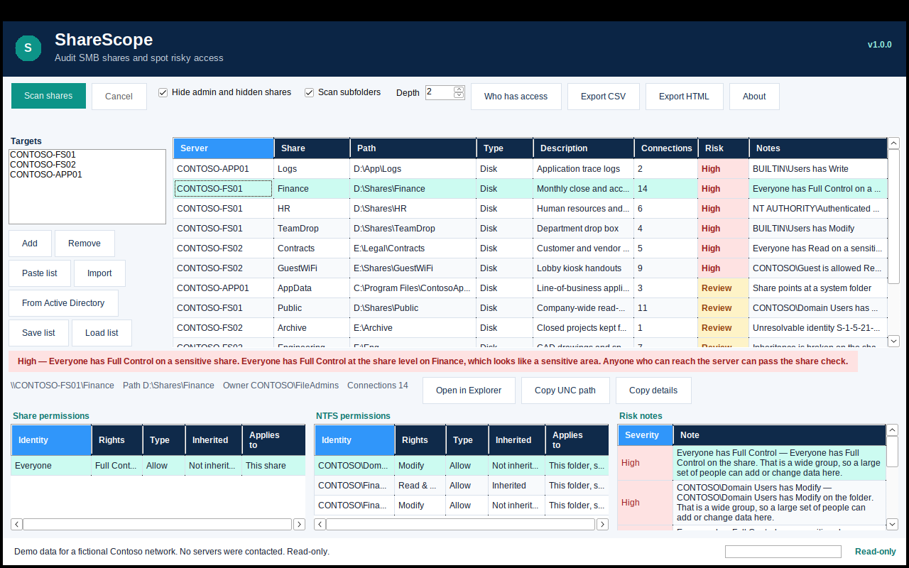

# ShareScope

ShareScope is a read-only desktop audit for SMB file shares on Windows 10 and Windows 11. It lists shares, reads the share ACL and the NTFS ACL on the share root, and flags access that is broader than it should be.



The screenshot is the built-in fictional Contoso dataset (`ShareScope.exe --demo`). No servers are contacted.

**ShareScope never changes share permissions, NTFS permissions, ownership, or files.** It only reads them. Opening a share starts Explorer. Export writes a file you choose.

## What you can do

- Audit the local computer, a pasted list, or a CSV/text import of server names and IP addresses.
- Optionally pull Windows Server computer names from Active Directory (the Servers OU, or the whole domain). If the PC is not domain-joined, that step is skipped and you add names yourself.
- List each share: server, name, path, type (Disk, Printer, IPC, Admin, Special), description, and current connections when Windows reports them.
- Hide administrative and hidden `$` shares.
- Show each access entry: identity, rights in plain words (Full Control, Change, Read, Modify, Read & Execute, Write), Allow or Deny, inherited or not, and what it applies to.
- Flag risky access and give the share an overall result of **OK**, **Review**, or **High**.
- Optionally walk subfolders to a depth you choose (default 2 in the app, off unless you ask) looking for broken inheritance and broad write access. Progress and Cancel are on the main window. Servers run in parallel with a small throttle.
- Ask who has access. On a domain, group membership comes from Active Directory. Otherwise only direct entries match, and the window says so.
- Open the share in Explorer, copy the UNC path, or copy the details.
- Export CSV and a self-contained HTML report. Save and load target lists.
- Run a scheduled audit from the command line.

Risk flags:

| Situation | Level |
| --- | --- |
| Everyone, Authenticated Users, Domain Users, or Users has Full Control, Change, Modify, or Write | High |
| Everyone has any allow right on a sensitive-looking share name or path | High |
| Anonymous or Guest is allowed in | High |
| A share ACL is missing (Windows treats that as unrestricted) | High |
| Broad read access | Review |
| Inheritance is broken on the share root or a subfolder | Review |
| An orphaned, unresolvable SID | Review |
| A Deny entry | Review |
| The share points at a drive root, Windows, or Program Files | Review |

Sensitive names include finance, HR, payroll, legal, contracts, and similar whole words. A specific group with Full Control, and Administrators on an admin share, are not treated as broad access.

## Command line

```text
ShareScope.exe --scan servers.txt --csv out.csv --html out.html
```

```text
--scan <file>     Text or CSV list of servers
--csv <file>      Write CSV results
--html <file>     Write an HTML report
--hide-admin      Skip administrative and hidden $ shares
--depth <0-10>    Subfolder levels to walk (default 0)
--help            Show help
```

Exit codes:

| Code | Meaning |
| --- | --- |
| 0 | Finished, and no High-risk share was found |
| 1 | Finished, and at least one High-risk share was found |
| 2 | Arguments or the server list could not be used, or the scan read no shares |

`--demo` is not listed in `--help`. It loads fictional Contoso servers and shares and does not use the network. Use it for screenshots. Combined with `--scan`, `--csv`, or `--html`, it writes a report from that same fictional data.

`servers.txt` is one name per line. Blank lines and `#` comments are ignored. A CSV with a Server, Computer, Name, or Host column uses that column.

## Build

Requires the .NET 8 SDK. The app project targets `net8.0-windows`. On Linux or macOS, publish with Windows targeting enabled, as below.

```bash
dotnet test -c Release
dotnet publish src/ShareScope.App/ShareScope.App.csproj -c Release -r win-x64 --self-contained -p:PublishSingleFile=true -p:IncludeNativeLibrariesForSelfExtract=true -p:EnableWindowsTargeting=true
```

The executable is:

```text
src/ShareScope.App/bin/Release/net8.0-windows/win-x64/publish/ShareScope.exe
```

It is a self-contained single file for 64-bit Windows. No installer and no separate .NET runtime are required. Copy `ShareScope.exe` and `packaging/README.txt` onto the machine you want to audit from.

Version 1.0.0. Per-monitor DPI awareness (PerMonitorV2) is set for the process, and the window uses DPI autoscaling, auto-sized controls, and a minimum size so text is not clipped at 100–175% scaling.

## Tests

```bash
dotnet test -c Release
```

The test project targets `net8.0` and does not call Windows networking APIs. Share enumeration, WMI, NTFS, and Active Directory are behind interfaces. Tests use fakes and the in-memory Contoso dataset, so they run on Linux.

## Project layout

- `src/ShareScope.Core` — target lists, rights summaries, risk rules, exports, scanning, and the CLI
- `src/ShareScope.Windows` — NetShareEnum, a WMI fallback, NTFS reads, subfolder walks, and Active Directory
- `src/ShareScope.App` — WinForms interface
- `tests/ShareScope.Tests` — xUnit tests

## Limitations

- "Who has access" matches access entries to the account and, when Active Directory is available, to groups it belongs to. It does not run a Windows access check, and it does not combine the share ACL and the NTFS ACL into one effective mask. Both layers are shown.
- Conditional ACEs and central access policies are not evaluated.
- The subfolder walk reports broken inheritance and broad, guest, anonymous, or orphaned entries. It does not list every folder it opened.
- Administrative shares are recognized by name (`C$` through `Z$`, `ADMIN$`, `IPC$`, `PRINT$`). Other names that end in `$` are hidden special shares.
- If `NetShareEnum` fails, WMI is the fallback. That path may not include the current connection count.
- Printer and IPC shares have no NTFS view.
- The account running ShareScope needs permission to read the share and the folder. A share that cannot be read is kept in the results with a review note.
- The Windows readers are compiled for `win-x64`. This repository's tests do not execute them.

## License

MIT. See [LICENSE](LICENSE).
